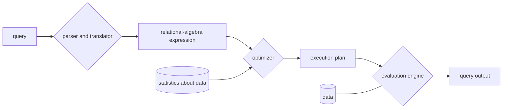

# MODUL PRAKTIKUM SD3203 – Teknologi Basis Data

**Program Studi Sains Data, Fakultas Sains, Institut Teknologi Sumatera – 2025**

# MODUL 4: Query Processing

---

## 1. Tujuan Praktikum

a. Memahami konsep dasar eksekusi kueri dalam basis data.
b. Mampu menerapkan beberapa metode pengambilan data yang digunakan dalam basis data.

---

## 2. Konsep Dasar

### 2.1. Query Processing

Query Processing adalah proses yang dilakukan oleh sistem basis data atau mesin pencari untuk menerjemahkan dan mengeksekusi permintaan (query) dari pengguna agar menghasilkan output yang sesuai. Proses ini bertujuan untuk mencari, mengoptimalkan, dan mengambil data dari database dengan efisiensi tinggi. Tahapan pada query processing:

a) **Parsing (Penguraian):** Query yang dimasukkan oleh pengguna diperiksa sintaksis dan semantiknya untuk memastikan bahwa permintaan valid.
b) **Translation (Penerjemahan):** Query diterjemahkan ke dalam bentuk representasi internal, seperti relasi dan operasi yang dapat dipahami oleh sistem basis data.
c) **Optimization (Optimasi):** Sistem memilih strategi eksekusi yang paling efisien untuk mengambil data, seperti memilih algoritma join yang lebih cepat atau penggunaan indeks, atau bahkan menggunakan *full scan*.
d) **Execution (Eksekusi):** Query yang telah dioptimasi dieksekusi oleh mesin database untuk mengambil hasil yang sesuai.



*Gambar 1. Skema query processing*

### 2.2. Operasi Seleksi dan Join

Dalam *query processing* operasi seleksi dan join digunakan untuk mengambil data dalam database sesuai dengan kondisi yang diinginkan. Keduanya memiliki peranan penting dalam proses pengambilan data pada database.

#### 2.2.1. Operasi Seleksi

Kueri seleksi adalah operasi yang mengambil subset baris dari suatu tabel berdasarkan kondisi tertentu. Tujuan utama dari seleksi adalah menyaring data sehingga hanya baris yang memenuhi kriteria yang akan dikembalikan. Dalam model relasional, operasi seleksi dilambangkan dengan σ (sigma). Database memiliki berbagai metode untuk menjalankan operasi seleksi tergantung pada jumlah data dan keberadaan indeks. Beberapa contoh metode yang dapat digunakan diantaranya adalah:

- **Linear Search (Pemindaian Linear):** Database memeriksa setiap baris dalam tabel satu per satu.
- **Index Search (Pencarian dengan Indeks):** Jika kolom dalam kondisi seleksi memiliki indeks, database akan menggunakan indeks untuk menemukan data dengan lebih cepat.

#### 2.2.2. Operasi Join

Join adalah operasi dalam query processing yang menggabungkan data dari dua atau lebih tabel berdasarkan hubungan di antara mereka. Join dilakukan berdasarkan kolom yang memiliki hubungan (*foreign key*). Dalam model relasional, operasi join dilambangkan dengan ⨝. Beberapa metode eksekusi join diantaranya:

- **Nested Loop Join:** metode dasar untuk menggabungkan dua tabel dalam eksekusi JOIN. Teknik ini bekerja dengan perulangan (loop) bersarang, di mana setiap baris dari tabel pertama (*outer table*) dibandingkan dengan setiap baris dari tabel kedua (*inner table*).
- **Sort-Merge Join:** salah satu metode untuk menggabungkan dua tabel dalam SQL JOIN, yang bekerja dengan dua langkah utama yaitu pengurutan dan penggabungan. Data akan diurutkan terlebih dahulu sebelum melakukan penggabungan.
- **Hash Join:** menggunakan struktur hash table untuk mempercepat pencocokan data.
- **Index Nested Loop Join:** menggunakan indeks untuk mempercepat proses pencarian data dalam join.

---

## 3. Database

### 3.1. Koneksi Database

Pada praktikum ini DBMS yang digunakan adalah **PostgreSQL** sedangkan untuk aplikasi pengelolaan yang digunakan adalah **DBeaver**. Pastikan PostgreSQL dan DBeaver sudah terinstal pada komputer sebelum memulai praktikum. Jika sudah terpasang, pastikan PostgreSQL telah terkoneksi pada DBeaver.

*Gambar 2. PostgreSQL dan DBeaver*

Berikut adalah cara melakukan koneksi PostgreSQL pada DBeaver:

1. Buka aplikasi **DBeaver**.
2. Klik **Database** > **New Database Connection**.
3. Pilih PostgreSQL kemudian klik **Next**.
4. Isi password dengan password yang sama saat instalasi PostgreSQL kemudian pada tab **PostgreSQL** ceklis semua pilihan yang ada. Tes koneksi dengan klik **Test Connection** pada bagian bawah. Jika sudah terkoneksi pilih **Finish** untuk menyelesaikan koneksi.

*Gambar 3. Tampilan saat pengaturan koneksi baru PostgreSQL ke DBeaver*

### 3.2. Pembuatan Database

Pada praktikum query processing ini, data yang digunakan adalah data sederhana berupa data rumah sakit. Untuk membuat database, terlebih dahulu skema baru dibuat dengan klik kanan pada **Schemas** kemudian pilih **Create New Schema** kemudian beri nama skema sesuai pilihan – contoh `rumah_sakit`. Skema yang telah dibuat akan muncul di bawah tab **Schema** (Gambar 4).

*Gambar 4. Skema baru yang berhasil dibuat*

Untuk membuat tabel, klik kanan pada klinik kemudian pilih **SQL Editor** lalu pilih **Open SQL script** kemudian pilih **New Script** sehingga muncul jendela editor untuk menulis kueri SQL (Gambar 5).

*Gambar 5. Tampilan jendela editor*

Untuk membuat tabel database kita dapat melakukannya secara manual dengan klik kanan pada **Table** kemudian pilih **Create New Table**, atau dapat menggunakan kueri berikut pada jendela editor untuk membuat tabel `pasien`, kemudian klik **Execute** untuk mengeksekusi kueri.

```sql
CREATE TABLE pasien (
    id SERIAL PRIMARY KEY,
    nama VARCHAR(50) NOT NULL,
    umur INT CHECK (umur > 0),
    alamat VARCHAR(100),
    jenis_kelamin VARCHAR(1) CHECK (jenis_kelamin IN ('L', 'P')) NOT NULL
);
```

Pada praktikum ini, ada beberapa tabel lagi yang digunakan yaitu `dokter` dan `rawat_inap`. Buatlah kedua tabel tersebut mengikuti langkah-langkah sebelumnya. Kueri dapat dituliskan di editor baru atau di bawah kueri sebelumnya dan saat eksekusi, kueri kemudian diblok lalu dieksekusi seperti langkah sebelumnya.

```sql
CREATE TABLE dokter (
    id SERIAL PRIMARY KEY,
    nama VARCHAR(50) NOT NULL,
    spesialis VARCHAR(50) NOT NULL,
    pengalaman_tahun INT CHECK (pengalaman_tahun >= 0)
);
```

```sql
CREATE TABLE rawat_inap (
    id SERIAL PRIMARY KEY,
    pasien_id INT,
    dokter_id INT,
    kamar VARCHAR(10),
    tanggal_masuk DATE,
    tanggal_keluar DATE,
    FOREIGN KEY (pasien_id) REFERENCES pasien(id),
    FOREIGN KEY (dokter_id) REFERENCES dokter(id)
);
```

Jika tabel-tabel tersebut telah berhasil dibuat, pada tab bagian **Table** akan muncul nama-nama tabel di bawahnya (Gambar 6).

*Gambar 6. Tampilan setelah tabel berhasil dibuat*

Jika nama-nama tabel yang telah dibuat tidak muncul, klik kanan pada **Schema** atau **Tables** kemudian pilih **Refresh**. Langkah selanjutnya adalah mengisi data pada tabel-tabel tersebut menggunakan kueri pada masing-masing tabel dengan menuliskan kueri seperti pada saat proses pembuatan tabel.

> **Catatan:** Pada modul asli, kueri `INSERT INTO pasien` menyertakan kolom `id_dokter`, padahal `CREATE TABLE pasien` di atas belum memiliki kolom tersebut. Agar INSERT dan kueri join pada bagian 4.2 berjalan, tambahkan kolom berikut **sebelum** mengisi data:
>
> ```sql
> ALTER TABLE pasien ADD COLUMN id_dokter INT REFERENCES dokter(id);
> ```
>
> Selain itu, tabel `dokter` sebaiknya diisi terlebih dahulu sebelum `pasien` agar foreign key valid.

```sql
INSERT INTO pasien (nama, umur, alamat, jenis_kelamin, id_dokter) VALUES
('Adit', 25, 'Jakarta', 'L',5),
('Budi', 40, 'Bandung', 'L',3),
('Citra', 30, 'Surabaya', 'P',3),
('Dewi', 22, 'Yogyakarta', 'P',1),
('Eka', 35, 'Medan', 'L',1),
('Faisal', 28, 'Palembang', 'L',2),
('Gita', 29, 'Semarang', 'P',2),
('Hadi', 50, 'Makassar', 'L',2),
('Indah', 32, 'Malang', 'P',4),
('Joko', 27, 'Bali', 'L',1),
('Kirana', 45, 'Solo', 'P',2),
('Lukman', 38, 'Pontianak', 'L',2),
('Maya', 26, 'Pekanbaru', 'P',4),
('Nina', 31, 'Mataram', 'P',4),
('Oscar', 48, 'Balikpapan', 'L',1),
('Putri', 34, 'Padang', 'P',1),
('Qori', 23, 'Bogor', 'L',3),
('Rudi', 39, 'Denpasar', 'L',3),
('Santi', 29, 'Aceh', 'P',5),
('Tina', 37, 'Banjarmasin', 'P',5),
('Umar', 33, 'Cirebon', 'L',2),
('Vina', 27, 'Manado', 'P',2),
('Wawan', 44, 'Jambi', 'L',2),
('Xenia', 30, 'Bengkulu', 'P',3),
('Yusuf', 36, 'Palangkaraya', 'L',1),
('Zahra', 28, 'Kupang', 'P',1),
('Alya', 41, 'Batam', 'P',3),
('Bambang', 50, 'Surakarta', 'L',4),
('Cindy', 24, 'Maluku', 'P',5),
('Dimas', 33, 'Tangerang', 'L',5);
```

```sql
INSERT INTO dokter (nama, spesialis, pengalaman_tahun) VALUES
('Dr. Andi', 'Kardiologi', 15),
('Dr. Budi', 'Ortopedi', 10),
('Dr. Cindy', 'Pediatri', 8),
('Dr. Dimas', 'Bedah Umum', 12),
('Dr. Erika', 'Neurologi', 11);
```

```sql
INSERT INTO rawat_inap (pasien_id, dokter_id, kamar, tanggal_masuk, tanggal_keluar) VALUES
(1, 1, 'A101', '2024-03-10', '2024-03-15'),
(2, 2, 'B202', '2024-03-12', NULL),
(3, 3, 'C303', '2024-03-14', '2024-03-20'),
(4, 4, 'D404', '2024-03-15', '2024-03-18'),
(5, 5, 'E505', '2024-03-17', NULL),
(6, 1, 'A102', '2024-03-18', '2024-03-22'),
(7, 2, 'B203', '2024-03-20', NULL),
(8, 3, 'C304', '2024-03-22', NULL),
(9, 4, 'D405', '2024-03-23', '2024-03-27'),
(10, 5, 'E506', '2024-03-25', NULL);
```

Data yang dibuat dapat dilihat dengan memilih tab **Data** saat nama tabel diklik di bagian kiri. Jika data masih tidak muncul, lakukan **Refresh** pada tiap tabel.

---

## 4. Query Processing

### 4.1. Operasi Seleksi

#### 4.1.1. Seleksi Sederhana

Pada kueri basis data, operasi seleksi digunakan untuk mengambil data yang memenuhi kondisi tertentu. Secara sederhana, kueri akan mengambil data mana saja yang memenuhi sebuah kondisi yang diberikan. Beberapa metode atau teknik pengambilan data dari yang paling sederhana dengan memindai satu per satu (linear) ataupun memindai data menggunakan indeksnya. Berikut adalah contoh operasi seleksi sederhana untuk menampilkan pasien dengan umur lebih dari 30 tahun.

```sql
SELECT * FROM pasien WHERE umur > 30;
```

Untuk melihat bagaimana kueri tersebut dieksekusi dapat menggunakan instruksi `EXPLAIN ANALYZE` seperti kueri berikut ini.

```sql
EXPLAIN ANALYZE SELECT * FROM pasien WHERE umur > 30;
```

Hasil keluaran dari instruksi tersebut merupakan *query plan* dengan rincian eksekusi kueri yang telah dibuat yang terdiri dari metode eksekusinya serta waktu yang dibutuhkan saat eksekusi berlangsung (Gambar 7).

```
Seq Scan on pasien  (cost=0.00..12.62 rows=70 width=352) (actual time=0.014..0.017 rows=17 loops=1)
  Filter: (umur > 30)
  Rows Removed by Filter: 13
Planning Time: 0.063 ms
Execution Time: 0.032 ms
```

*Gambar 7. Query plan dari eksekusi yang telah dijalankan*

#### 4.1.2. Seleksi Menggunakan Indeks

Pada sebuah data besar, operasi dapat menggunakan pencarian indeks untuk mengoptimalisasi pencarian. Berikut adalah kueri untuk membuat indeks.

```sql
CREATE INDEX indx_umur ON pasien(umur);
```

Karena data yang digunakan kecil dan kita ingin mencoba menggunakan indeks, maka paksa PostgreSQL untuk menggunakan indeks menggunakan kueri berikut.

```sql
SET enable_seqscan = OFF;
```

Setelah dinon-aktifkan, lakukan operasi seleksi menggunakan kode berikut.

```sql
EXPLAIN ANALYZE SELECT * FROM pasien WHERE umur > 30;
```

Dari hasil seleksi menggunakan indeks, diperoleh waktu eksekusi yang lebih lama dibanding menggunakan metode pencarian sederhana. Gambar 8 berikut adalah query plan dari eksekusi seleksi menggunakan indeks.

```
Bitmap Heap Scan on pasien  (cost=4.69..15.56 rows=70 width=356) (actual time=0.008..0.008 rows=0 ...)
  Recheck Cond: (umur > 30)
  ->  Bitmap Index Scan on indx_umur  (cost=0.00..4.67 rows=70 width=0) (actual time=0.003..0.003 ...)
        Index Cond: (umur > 30)
Planning Time: 0.093 ms
Execution Time: 0.024 ms
```

*Gambar 8. Query plan dari eksekusi yang telah dijalankan saat menggunakan indeks*

Pada hasil tersebut, kedua teknik memiliki selisih yang signifikan karena data yang digunakan kecil. Selain itu, walaupun indeks sudah digunakan untuk membantu memindai data, terlalu banyak baris yang cocok sehingga kueri tetap saja membaca seluruh baris yang mengakibatkan cost lebih banyak. Pemilihan antara seleksi sederhana ataupun menggunakan indeks haruslah disesuaikan dengan kebutuhan serta bentuk data yang digunakan. Sebelum melakukan praktikum selanjutnya, aktifkan kembali seqscan dengan mengaturnya menjadi `ON`:

```sql
SET enable_seqscan = ON;
```

### 4.2. Operasi Join

Operasi **JOIN** dalam SQL digunakan untuk menggabungkan data dari dua atau lebih tabel berdasarkan hubungan antara kolom tertentu. Join sangat penting dalam query processing untuk menggabungkan data secara efisien. Pada praktikum ini akan dilakukan implementasi penggunaan join saat mengambil suatu data yang memenuhi kondisi tertentu. Percobaan dilakukan menggunakan dua teknik pencarian pada join yaitu *nested loop join* dan *sort merge join*.

#### 4.2.1. Nested Loop Join

**Nested Loop Join** adalah metode join **paling sederhana** di mana setiap baris dalam tabel pertama dibandingkan dengan setiap baris dalam tabel kedua (**brute force**). Karena pada praktikum ini data yang digunakan adalah data kecil tetapi ingin menggunakan nested loop join, hash join serta merge join dinonaktifkan terlebih dahulu menggunakan kueri berikut.

```sql
SET enable_hashjoin = OFF;
SET enable_mergejoin = OFF;
```

Jika kueri di atas tidak dijalankan, PostgreSQL akan memilih metode eksekusi yang memiliki cost paling minimum. Untuk mencoba kueri nested loop join gunakan kueri berikut.

```sql
EXPLAIN ANALYZE
SELECT pasien.nama AS Nama_Pasien, dokter.nama AS Nama_Dokter, dokter.spesialis
FROM pasien
JOIN dokter ON pasien.id_dokter = dokter.id;
```

Pada kueri nested loop join, PostgreSQL akan membaca tabel `pasien` terlebih dahulu (*Outer Table*) kemudian untuk setiap pasien, PostgreSQL akan mencari kecocokan di tabel `dokter` berdasarkan `id_dokter` (*Inner Table*). Karena jumlah pasien lebih banyak dari dokter, PostgreSQL akan mengulang proses pencocokan ini berulang kali. Hasil analisa kueri menggunakan nested loop join pada data rumah_sakit dapat dilihat pada Gambar 9.

```
Nested Loop  (cost=0.15..94.51 rows=210 width=354) (actual time=0.051..0.079 rows=30 loops=1)
  ->  Seq Scan on pasien  (cost=0.00..12.10 rows=210 width=122) (actual time=0.025..0.026 rows=30 loops=1)
  ->  Index Scan using dokter_pkey on dokter  (cost=0.15..0.39 rows=1 width=240) (actual time=0.001..0.001 rows=1 ...)
        Index Cond: (id = pasien.id_dokter)
Planning Time: 0.181 ms
Execution Time: 0.113 ms
```

*Gambar 9. Hasil analisa eksekusi nested loop join*

Sebelum memasuki praktikum operasi join berikutnya, aktifkan kembali hash join dan merge join dengan set kembali menjadi `ON`:

```sql
SET enable_hashjoin = ON;
SET enable_mergejoin = ON;
```

#### 4.2.2. Sort-Merge Join

**Sort-Merge Join** adalah salah satu metode eksekusi **JOIN** dalam SQL yang bekerja dalam dua tahap utama yaitu *sorting* dan *merging*. Teknik ini cocok digunakan saat:

- Cocok untuk dataset besar jika indeks tidak tersedia.
- Efektif ketika kedua tabel sudah terurut pada kolom yang digunakan untuk join.
- Digunakan ketika Hash Join tidak optimal (misalnya jika tabel tidak cukup muat di memori).

Berikut adalah kueri untuk menjalankan sort-merge join.

```sql
EXPLAIN ANALYZE
SELECT pasien.nama AS Nama_Pasien, dokter.nama AS Nama_Dokter, dokter.spesialis
FROM pasien
JOIN dokter ON pasien.id_dokter = dokter.id
ORDER BY pasien.id_dokter, dokter.id;
```

Dari kueri di atas, JOIN dilakukan antara tabel `pasien` dan `dokter` berdasarkan kolom `id_dokter`. `ORDER BY` memastikan kedua tabel diurutkan berdasarkan kolom yang digunakan dalam join. Berikut adalah hasil analisa eksekusi kuerinya.

```
Merge Join  (cost=45.54..50.19 rows=210 width=362) (actual time=0.039..0.043 rows=30 loops=1)
  Merge Cond: (pasien.id_dokter = dokter.id)
  ->  Sort  (cost=20.20..20.72 rows=210 width=122) (actual time=0.020..0.021 rows=30 loops=1)
        Sort Key: pasien.id_dokter
        Sort Method: quicksort  Memory: 25kB
        ->  Seq Scan on pasien  (cost=0.00..12.10 rows=210 width=122) (actual time=0.010..0.013 rows=30 ...)
  ->  Sort  (cost=25.34..26.09 rows=300 width=240) (actual time=0.017..0.017 rows=5 loops=1)
        Sort Key: dokter.id
        Sort Method: quicksort  Memory: 25kB
        ->  Seq Scan on dokter  (cost=0.00..13.00 rows=300 width=240) (actual time=0.003..0.004 rows=5 ...)
Planning Time: 0.110 ms
Execution Time: 0.065 ms
```

*Gambar 10. Tampilan hasil analisa eksekusi menggunakan sort merge join*
